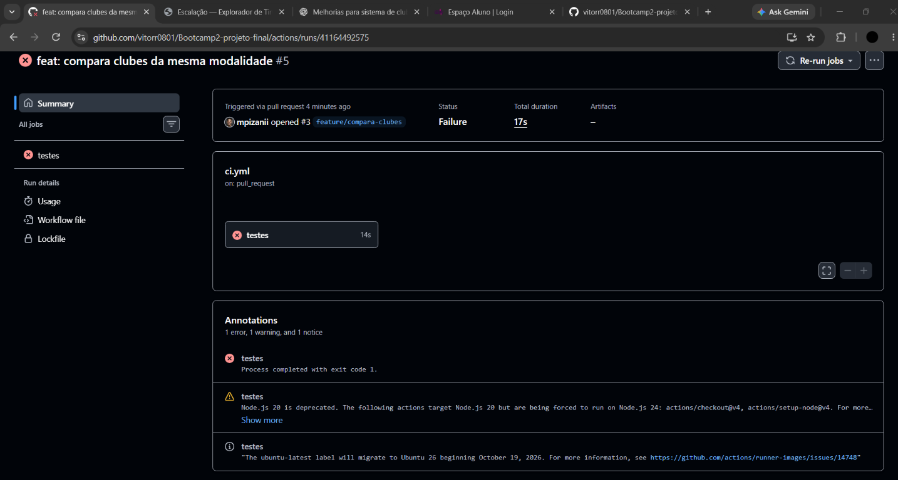
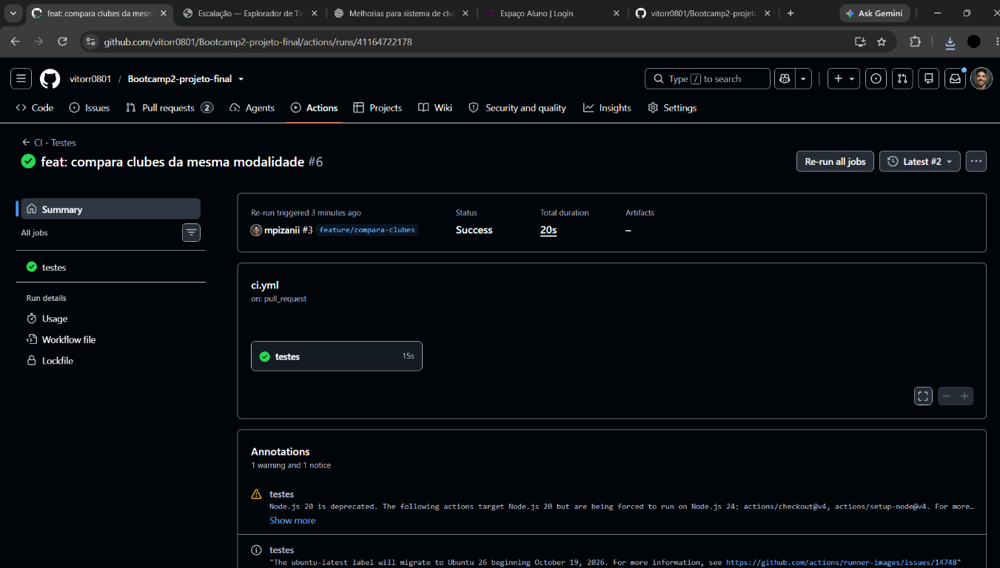
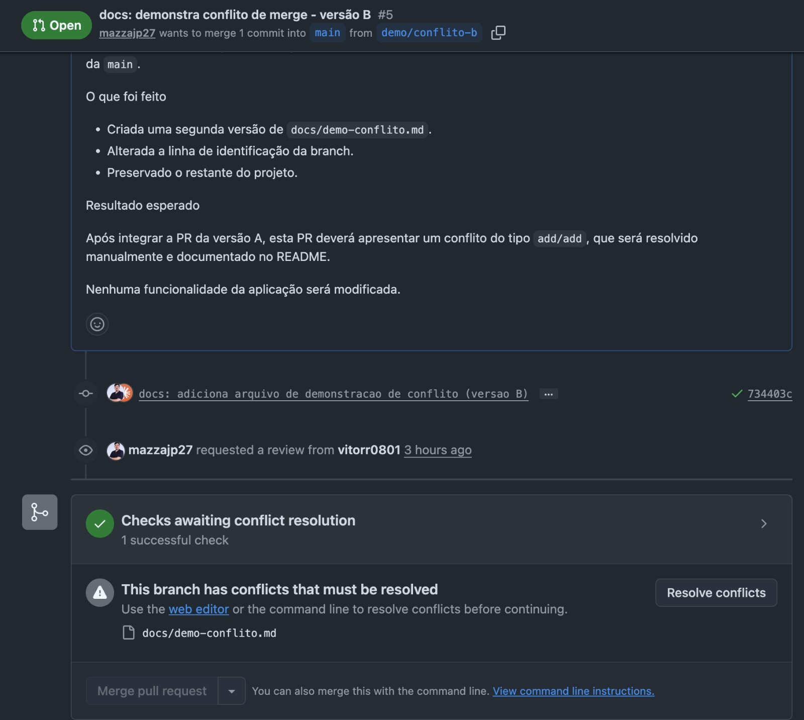
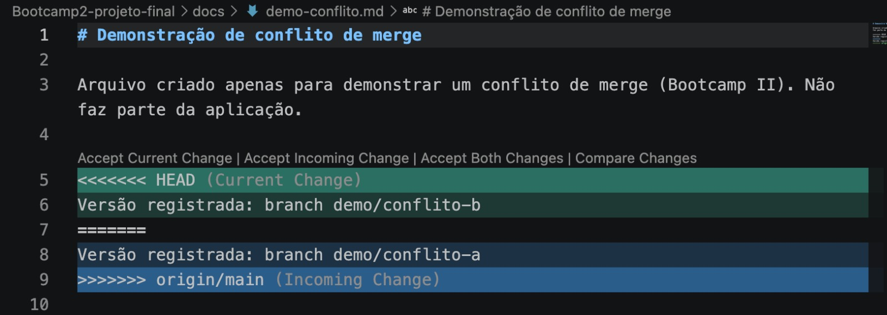

# Escalação — Explorador de Times

Projeto final do Bootcamp 2, desenvolvido em grupo com fluxo de Pull Requests, testes automatizados no GitHub Actions e imagem publicada no Docker Hub.

## 1. Integrantes e responsabilidades

| Nome | Matrícula | Usuário GitHub | Funcionalidade pela qual é responsável | Principal PR |
|------|-----------|----------------|----------------------------------------|--------------|
| Vitor Reis Rodrigues de Souza | 22308730 | [vitorr0801](https://github.com/vitorr0801) | Nota de 1 a 5 estrelas nos favoritos, com média geral (e a base do projeto: busca, favoritos e anotações) e Funcionalidade de anotações sobre o time. | https://github.com/vitorr0801/Bootcamp2-projeto-final/pull/1 |
| João Pedro Venturoso Mazza | 22302176 | [mazzajp27](https://github.com/mazzajp27) | Busca, filtros por avaliação e ordenação dos times favoritos, com testes automatizados. | https://github.com/vitorr0801/Bootcamp2-projeto-final/pull/2 |
| Matheus Pizani de Albuquerque | 22309128 | [mpizanii](https://github.com/mpizanii) | Compara dados de times de mesma modalidade | https://github.com/vitorr0801/Bootcamp2-projeto-final/pull/3 |

## 2. A aplicação

**Escalação** é uma aplicação web para explorar times de futebol, basquete, hóquei no gelo, beisebol e futebol americano. A pessoa pode:

- buscar um time pelo nome (ex.: Real Madrid, Lakers, Cruzeiro);
- navegar por esporte → país → liga → equipe, com filtro por nome dentro da liga;
- **favoritar** times, que ficam salvos no banco de dados;
- escrever uma **anotação** pessoal em cada favorito;
- dar uma **nota de 1 a 5 estrelas** a cada favorito e ver a **média** das suas notas;
- **buscar entre os favoritos** pelo nome, sem diferenciar acentos nem letras maiúsculas e minúsculas;
- **ordenar os favoritos** por mais recentes (padrão), nome A–Z, nome Z–A, maior nota ou menor nota;
- **filtrar os favoritos por nota**, de 1 a 5 estrelas;
- **comparar dois ou mais clubes da mesma modalidade** lado a lado, com país, fundação, competição, estádio/arena e modalidade (quando a API fornecer o dado);
- usar a busca, o filtro e a ordenação sem perder **anotações ainda não salvas**; quando nenhum favorito atende aos filtros, a aplicação avisa e oferece um botão para limpá-los, sem alterar os favoritos salvos;
- excluir favoritos.

### API consumida

[TheSportsDB](https://www.thesportsdb.com/) (chave gratuita `123`), com os endpoints `searchteams.php` (busca por nome), `search_all_leagues.php` (ligas de um país e esporte) e `search_all_teams.php` (times de uma liga). A versão gratuita retorna no máximo 10 times por liga, e a aplicação avisa quando isso acontece.

### Banco de dados

Supabase (PostgreSQL gerenciado, região Americas), acessado pelo navegador com `supabase-js`, usando a URL do projeto e a chave **anon/public**. Os dados não ficam no navegador: aparecem em qualquer dispositivo.

Tabela `favoritos`:

| Coluna | Tipo | Descrição |
|--------|------|-----------|
| `id` | bigint (identity, PK) | Identificador |
| `criado_em` | timestamptz | Quando foi favoritado |
| `id_time` | text, único | `idTeam` da TheSportsDB (evita favoritar o mesmo time duas vezes) |
| `nome_time`, `escudo_url`, `liga`, `esporte`, `pais`, `estadio` | text | Dados do time |
| `ano_fundacao` | integer | Ano de fundação |
| `anotacao` | text (máx. 500) | Anotação pessoal |
| `nota` | smallint (1 a 5) | Nota dada ao time |

O script de criação é o [`banco.sql`](banco.sql) (colar no SQL Editor do Supabase).

**Limitação conhecida (RLS):** o RLS está ativo, mas com políticas abertas para o papel `anon` (`select`, `insert`, `update` e `delete`). Como não há login, qualquer pessoa com a chave anon pode ler, criar, editar e apagar favoritos, e a lista é compartilhada entre todos. Em produção usaríamos Supabase Auth, uma coluna `user_id` e políticas por usuário.

### Estrutura do código

| Arquivo | Função |
|---------|--------|
| `index.html`, `style.css` | Interface |
| `script.js` | Tela, chamadas à API e ao Supabase |
| `utils.js` | Funções puras (normalizar texto, traduzir país, escapar HTML, converter time ↔ registro do banco, validar nota, calcular média, buscar, filtrar e ordenar favoritos e preparar a comparação entre clubes), que são as testadas |
| `utils.test.js` | Testes automatizados (Jest) |
| `banco.sql` | Criação da tabela e das políticas |
| `Dockerfile`, `.dockerignore` | Imagem Docker |
| `.github/workflows/ci.yml` | Integração contínua |

## 3. Como executar

### Localmente

1. Clone o repositório.
2. Crie um projeto no Supabase, rode o `banco.sql` no SQL Editor e copie a **Project URL** e a chave **anon/public**.
3. Preencha `SUPABASE_URL` e `SUPABASE_ANON_KEY` no começo do `script.js`. (O repositório já vem com os dados do projeto do grupo.)
4. Abra o `index.html` no navegador, ou use a extensão Live Server do VS Code.

### Com Docker

Imagem: https://hub.docker.com/r/vitorceub/bootcamp2-projeto-final

```bash
docker run -d -p 8080:80 vitorceub/bootcamp2-projeto-final:latest
```

Depois abra http://localhost:8080. Não são necessárias variáveis de ambiente: a URL e a chave anon do Supabase do grupo já estão no código da imagem, e o container só precisa de acesso à internet (TheSportsDB e Supabase).

Para parar e remover: `docker ps`, `docker stop <nome>` e `docker rm <nome>`.

Para construir a imagem localmente:

```bash
docker build -t bootcamp2-projeto-final .
docker run -d -p 8080:80 --name app bootcamp2-projeto-final
```

## 4. Como rodar os testes

Requer Node.js 20 ou mais novo.

```bash
npm install
npm test
```

Os testes (Jest) ficam em `utils.test.js` e cobrem as funções de `utils.js`. São 52 testes:

- **25 testes anteriores:** normalização de texto, tradução de países, escape de HTML, conversão entre o time da API e o registro do banco, preparação da anotação, validação da nota, cálculo e formatação da média e mensagens de erro do banco;
- **19 testes novos:** busca dos favoritos pelo nome, filtro por nota, ordenação (A–Z, Z–A, maior e menor nota, mais recentes) e a combinação dos três, incluindo nomes acentuados, favoritos sem nota e a garantia de que o array original de favoritos não é modificado.
- **8 testes da comparação:** seleção de campos conforme a modalidade, liga ou competição, distinção entre estádio e arena, tratamento de dados ausentes e validação de clubes da mesma modalidade.

No GitHub, o workflow `.github/workflows/ci.yml` roda `npm test` a cada Pull Request e a cada push na `main`.

## 5. Fluxo de trabalho do grupo

A `main` é protegida por um ruleset: ninguém commita direto nela. Cada funcionalidade nasce numa branch `feature/...` e chega à `main` por Pull Request, que precisa de **1 aprovação** de outro integrante e do check **testes** verde. Cada PR tem título claro, descrição (o que foi feito, por que e como testar) e um revisor, que deixa pelo menos um comentário antes de aprovar.

## 6. Evidências

### PR bloqueada pelo CI

Durante a validação da funcionalidade de comparação de clubes, foi criada uma execução com um teste propositalmente quebrado. O workflow do GitHub Actions identificou a falha e bloqueou o CI da Pull Request, impedindo a aprovação enquanto os testes não fossem corrigidos.



**Link da pipeline com o CI bloqueado:** https://github.com/vitorr0801/Bootcamp2-projeto-final/actions/runs/41164492575

Após a correção do teste, o workflow foi executado novamente. Todos os testes passaram com sucesso e o CI foi liberado para a continuidade da revisão e do merge.



**Link da pipeline após a correção:** https://github.com/vitorr0801/Bootcamp2-projeto-final/actions/runs/41164722178

### Conflito de merge

Para demonstrar o fluxo de resolução de conflitos, o grupo fez uma **simulação controlada** usando duas branches temporárias e um arquivo de demonstração, sem tocar no código da aplicação.

| Item | Detalhe |
|------|---------|
| Branches | `demo/conflito-a` e `demo/conflito-b`, ambas criadas a partir da `main` |
| Pull Requests | [#4](https://github.com/vitorr0801/Bootcamp2-projeto-final/pull/4) (`demo/conflito-a`) e [#5](https://github.com/vitorr0801/Bootcamp2-projeto-final/pull/5) (`demo/conflito-b`) |
| Arquivo | `docs/demo-conflito.md` |
| Tipo de conflito | `add/add`: as duas branches criaram o mesmo arquivo com conteúdo diferente na mesma linha |
| Resolvido por | João Pedro Venturoso Mazza |

**Como aconteceu:** as duas branches criaram `docs/demo-conflito.md` com o mesmo conteúdo, exceto a linha `Versão registrada`, que em cada uma identificava a própria branch. A PR #4 foi aprovada e integrada à `main` primeiro. A partir daí, o GitHub passou a indicar que a PR #5 tinha conflitos e bloqueou o merge.



**Como foi identificado:** na branch `demo/conflito-b`, o conflito foi reproduzido localmente:

```bash
git switch demo/conflito-b
git fetch origin
git merge origin/main
# CONFLICT (add/add): Merge conflict in docs/demo-conflito.md
```

O `git status` listou o arquivo como `both added`, e o VS Code destacou o trecho entre os marcadores `<<<<<<< HEAD`, `=======` e `>>>>>>> origin/main`, com a versão da branch B de um lado e a da branch A, vinda da `main`, do outro.



**Como foi resolvido:** o conflito foi resolvido manualmente. Os marcadores foram removidos e as duas versões foram combinadas numa única linha:

```
Versão registrada: branches demo/conflito-a e demo/conflito-b (conflito resolvido manualmente)
```

Em seguida, o arquivo foi marcado como resolvido com `git add docs/demo-conflito.md`, o merge foi concluído com um commit de resolução e a branch foi enviada ao GitHub para atualizar a PR #5.

[PREENCHER: print da PR #5 sem conflitos e com o CI aprovado]

**Impacto na aplicação:** nenhum. A simulação alterou apenas `docs/demo-conflito.md` e este README. Nenhuma funcionalidade foi alterada, e a pasta `docs/` e os arquivos `.md` ficam fora da imagem Docker (`.dockerignore`).
